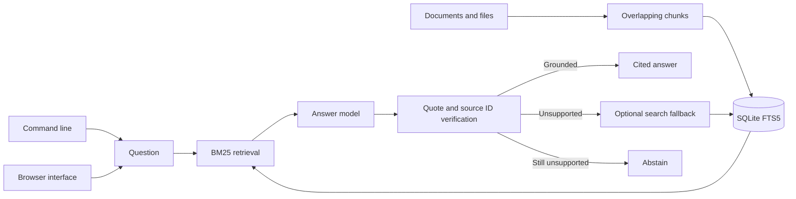

# Citation Grounded Rag

Index text in SQLite FTS5, retrieve relevant passages, require exact source quotes for every citation, and optionally use a search fallback.

`ingest_file` loads UTF-8 text with a size limit. Ingestion uses overlapping chunks and replaces existing passages for the same source atomically. `sources()` and `delete_source()` support index maintenance.

## Quick start

Requires Python 3.11 or newer. From this repository:

```powershell
python -m venv .venv
.\.venv\Scripts\Activate.ps1
python -m pip install -e '.[dev]'
pytest -q
```

On macOS or Linux:

```bash
python3 -m venv .venv
source .venv/bin/activate
python -m pip install -e '.[dev]'
pytest -q
```

For live model calls, set `OPENAI_API_KEY` and optionally `OPENAI_MODEL` and `OPENAI_BASE_URL` as shown in `.env.example`. The test suite uses stubs and needs no model key.

The installed `citation-rag` command maintains a durable knowledge base. Ingest and search work without a model key; `ask` uses the configured model and verifies its source quotes:

```bash
citation-rag --db knowledge.sqlite3 ingest policy.txt
citation-rag --db knowledge.sqlite3 sources
citation-rag --db knowledge.sqlite3 search "refund policy"
citation-rag --db knowledge.sqlite3 ask "When can I get a refund?"
```

Run `citation-rag --help` for delete and retrieval options. The CLI emits JSON for scripting.

For the browser product, run `citation-rag --db knowledge.sqlite3 serve --port 8080` and open `http://127.0.0.1:8080`. The browser can ingest pasted text, search offline, ask grounded questions, list sources, and delete a source. The server binds to localhost.

```python
from citation_grounded_rag.engine import CitationRAG
from citation_grounded_rag.llm import OpenAICompatibleLLM

rag = CitationRAG("knowledge.sqlite3", OpenAICompatibleLLM.from_env())
rag.ingest("policy-v1", "Refunds are available within 30 days of purchase.")
answer = rag.ask("When are refunds available?")
print(answer.text, [(p.source, p.id) for p in answer.citations], answer.grounded)
```

## Architecture



| Component | Responsibility |
|---|---|
| Ingestion | Replaces a source atomically and supports file size limits. |
| Retrieval | Uses SQLite FTS5 to rank indexed passages. |
| Grounding gate | Requires exact evidence quotes from retrieved passage IDs. |

Ingest -> fixed text chunks -> SQLite FTS5 -> BM25 retrieval -> model answer with evidence quotes -> quote and source ID validation -> optional search fallback -> answer or abstention.

See [ARCHITECTURE.md](ARCHITECTURE.md) for components, state, failure behavior, and operations.

## Deployment and safety

See [DEPLOYMENT.md](DEPLOYMENT.md) for the non-root container, token-protected browser, data mounts, and release checks.

Exact quotes and source IDs are checked, but entailment of the full answer is not formally proved. Add domain evaluations and human review for high stakes use. Ingestion replaces passages for a source atomically.

Install this as a library in an authenticated application or worker. Supply the LLM adapter through dependency injection. Keep secrets in environment variables, never in source control.

## Verification

`pytest -q` runs deterministic tests. GitHub Actions runs the same suite on pushes and pull requests.

## License

MIT. See [LICENSE](LICENSE).
