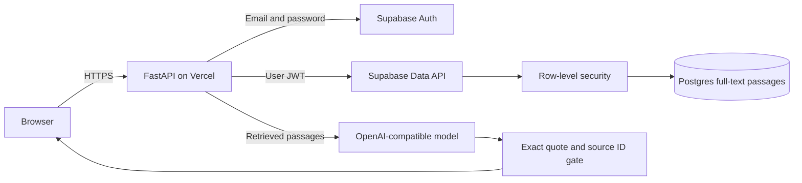
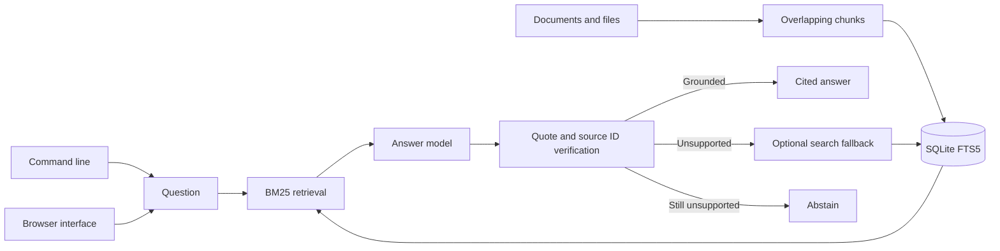

# Citation Grounded RAG

## About

This app helps you ask questions about your own documents and see where an answer came from. Add text to a private knowledge base, search it directly, or ask a question. For model-generated answers, the app checks that every cited quote appears exactly in a retrieved passage. If it cannot verify support, it returns an uncertain answer instead of presenting a citation it cannot back up.

### What you can do

- Add pasted text in the [hosted app](https://citation-grounded-rag.vercel.app/) or ingest UTF-8 files with the local CLI.
- Search documents without spending model tokens.
- Ask questions and inspect the passages cited in the answer.
- List and remove sources when your knowledge base changes.

The hosted app uses email and password accounts and keeps each user's passages separate. The local CLI and browser use a SQLite index; the hosted app uses Postgres. Exact quote matching checks the evidence text, but it does not mathematically prove that every sentence in the answer follows from that evidence. Review answers before using them for important decisions.

## Quick start

Requires Python 3.11 or newer. From this repository:

```powershell
python -m venv .venv
.\.venv\Scripts\Activate.ps1
python -m pip install -e '.[dev]'
pytest -q
```

On macOS or Linux:

```bash
python3 -m venv .venv
source .venv/bin/activate
python -m pip install -e '.[dev]'
pytest -q
```

For live model calls, set `OPENAI_API_KEY` and optionally `OPENAI_MODEL` and `OPENAI_BASE_URL` as shown in `.env.example`. The test suite uses stubs and needs no model key.

The installed `citation-rag` command maintains a durable knowledge base. Ingest and search work without a model key; `ask` uses the configured model and verifies its source quotes:

```bash
citation-rag --db knowledge.sqlite3 ingest policy.txt
citation-rag --db knowledge.sqlite3 sources
citation-rag --db knowledge.sqlite3 search "refund policy"
citation-rag --db knowledge.sqlite3 ask "When can I get a refund?"
```

Run `citation-rag --help` for delete and retrieval options. The CLI emits JSON for scripting.

For the browser product, run `citation-rag --db knowledge.sqlite3 serve --port 8080` and open `http://127.0.0.1:8080`. The browser can ingest pasted text, search offline, ask grounded questions, list sources, and delete a source. The server binds to localhost.

```python
from citation_grounded_rag.engine import CitationRAG
from citation_grounded_rag.llm import OpenAICompatibleLLM

rag = CitationRAG("knowledge.sqlite3", OpenAICompatibleLLM.from_env())
rag.ingest("policy-v1", "Refunds are available within 30 days of purchase.")
answer = rag.ask("When are refunds available?")
print(answer.text, [(p.source, p.id) for p in answer.citations], answer.grounded)
```

## Architecture

The hosted web app uses Supabase Auth and a Postgres full-text index. Each passage carries the authenticated user's ID; row-level policies isolate users.



The CLI/container architecture below remains available for local workflows.



| Component | Responsibility |
|---|---|
| Ingestion | Replaces a source atomically and supports file size limits. |
| Retrieval | Uses SQLite FTS5 to rank indexed passages. |
| Grounding gate | Requires exact evidence quotes from retrieved passage IDs. |

Ingest -> fixed text chunks -> SQLite FTS5 -> BM25 retrieval -> model answer with evidence quotes -> quote and source ID validation -> optional search fallback -> answer or abstention.

See [ARCHITECTURE.md](ARCHITECTURE.md) for components, state, failure behavior, and operations.

## Deployment and safety

The hosted app is available at [citation-grounded-rag.vercel.app](https://citation-grounded-rag.vercel.app/). Signed-in users can ingest and search private text without a model key. Grounded answers need the configured model provider.

See [DEPLOYMENT.md](DEPLOYMENT.md) for the Supabase migration, Vercel deployment, the non-root container option, and release checks.

Exact quotes and source IDs are checked, but entailment of the full answer is not formally proved. Add domain evaluations and human review for high stakes use. Ingestion replaces passages for a source atomically.

Install this as a library in an authenticated application or worker. Supply the LLM adapter through dependency injection. Keep secrets in environment variables, never in source control.

## Verification

`pytest -q` runs deterministic tests. GitHub Actions runs the same suite on pushes and pull requests.

## Product guide

### A document-to-answer workflow

1. Give a document a source name, such as `refund-policy`, and add its text. Adding that source again replaces its earlier passages.
2. Use `search` to confirm that the relevant passages are present. Search works without a model call.
3. Use `ask` for a question. The model receives a bounded set of retrieved passages and returns an answer with evidence quotes.
4. Inspect the cited passages. If the quote is absent or confidence is too low, the app abstains instead of displaying a grounded answer.
5. Remove a source when it becomes outdated. The hosted app deletes only passages owned by the signed-in user.

| Interface | Supported input | Stored where |
|---|---|---|
| Hosted web app | Pasted text with a source name | User-owned rows in Supabase Postgres |
| Local CLI | UTF-8 files or text commands | A local SQLite FTS5 database you choose |
| Local browser | Pasted text | The same local SQLite database |

### How grounding works

The app splits source text into overlapping passages so a relevant sentence near a chunk boundary can still be found. Search ranks passages and sends only the selected context to the model. The model must provide a passage ID and an exact substring as evidence. A second validation pass checks that the ID exists in the retrieved set and the quote appears in that passage. A malformed or unsupported response is retried once in the hosted path, then safely rejected.

This is a quote check, not a full factual proof. A response can still misinterpret a valid quote. For legal, medical, financial, or other consequential uses, add a domain evaluation set and a human review step.

### Configuration and privacy

| Variable | Needed for | Purpose |
|---|---|---|
| `OPENAI_API_KEY` | `ask` | Server-side model credential. |
| `OPENAI_BASE_URL` and `OPENAI_MODEL` | Non-default model | Chat endpoint and model ID. |
| `SUPABASE_URL` and `SUPABASE_PUBLISHABLE_KEY` | Hosted app | Authentication and user-scoped database calls. |

Hosted database calls use the signed-in user's access token, so row-level security restricts reads and writes to that user. The service-role key is for trusted operator checks only. Source text is sent to the configured model provider when a user asks a question; plain search stays in the database. The shared migration history is in [agent-suite-platform](https://github.com/kh-bikash/agent-suite-platform).

### Operating the app

The hosted endpoint provides `/healthz` and requires sign-in for document actions. `scripts/smoke_hosted.py` creates two temporary accounts, checks that one cannot read or delete the other's passages, exercises the hosted API, and deletes both accounts. Run it after schema or deployment changes. A document quota is enforced in the database; provider availability and free-tier limits still affect live answers. See [DEPLOYMENT.md](DEPLOYMENT.md) and [SECURITY.md](SECURITY.md) before public promotion.

### Common issues

| Symptom | Check |
|---|---|
| Search returns no passages | Confirm the source was ingested and try terms that appear in its text. Full-text search is lexical. |
| An answer abstains | Inspect the retrieved passages. The model may not have supplied an exact valid quote, or the material may not answer the question. |
| An old policy still appears | Re-ingest under the same source name to replace it, or delete the old source. |
| A hosted write is denied | Confirm sign-in, user ownership, and the document quota. |

Keep source names stable across updates and run the isolation smoke test after changing policies or RPC grants. Search quality should be evaluated on real questions from the intended domain, not only on the example policy text.

## License

MIT. See [LICENSE](LICENSE).
