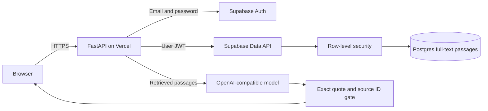
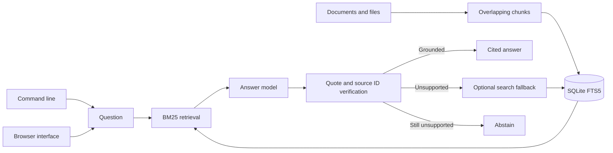

# Citation Grounded RAG

## About

This app helps you ask questions about your own documents and see where an answer came from. Add text to a private knowledge base, search it directly, or ask a question. For model-generated answers, the app checks that every cited quote appears exactly in a retrieved passage. If it cannot verify support, it returns an uncertain answer instead of presenting a citation it cannot back up.

### What you can do

- Add pasted text in the [hosted app](https://citation-grounded-rag.vercel.app/) or ingest UTF-8 files with the local CLI.
- Search documents without spending model tokens.
- Ask questions and inspect the passages cited in the answer.
- List and remove sources when your knowledge base changes.

The hosted app uses email and password accounts and keeps each user's passages separate. The local CLI and browser use a SQLite index; the hosted app uses Postgres. Exact quote matching checks the evidence text, but it does not mathematically prove that every sentence in the answer follows from that evidence. Review answers before using them for important decisions.

## Quick start

Requires Python 3.11 or newer. From this repository:

```powershell
python -m venv .venv
.\.venv\Scripts\Activate.ps1
python -m pip install -e '.[dev]'
pytest -q
```

On macOS or Linux:

```bash
python3 -m venv .venv
source .venv/bin/activate
python -m pip install -e '.[dev]'
pytest -q
```

For live model calls, set `OPENAI_API_KEY` and optionally `OPENAI_MODEL` and `OPENAI_BASE_URL` as shown in `.env.example`. The test suite uses stubs and needs no model key.

The installed `citation-rag` command maintains a durable knowledge base. Ingest and search work without a model key; `ask` uses the configured model and verifies its source quotes:

```bash
citation-rag --db knowledge.sqlite3 ingest policy.txt
citation-rag --db knowledge.sqlite3 sources
citation-rag --db knowledge.sqlite3 search "refund policy"
citation-rag --db knowledge.sqlite3 ask "When can I get a refund?"
```

Run `citation-rag --help` for delete and retrieval options. The CLI emits JSON for scripting.

For the browser product, run `citation-rag --db knowledge.sqlite3 serve --port 8080` and open `http://127.0.0.1:8080`. The browser can ingest pasted text, search offline, ask grounded questions, list sources, and delete a source. The server binds to localhost.

```python
from citation_grounded_rag.engine import CitationRAG
from citation_grounded_rag.llm import OpenAICompatibleLLM

rag = CitationRAG("knowledge.sqlite3", OpenAICompatibleLLM.from_env())
rag.ingest("policy-v1", "Refunds are available within 30 days of purchase.")
answer = rag.ask("When are refunds available?")
print(answer.text, [(p.source, p.id) for p in answer.citations], answer.grounded)
```

## Architecture

The hosted web app uses Supabase Auth and a Postgres full-text index. Each passage carries the authenticated user's ID; row-level policies isolate users.



The CLI/container architecture below remains available for local workflows.



| Component | Responsibility |
|---|---|
| Ingestion | Replaces a source atomically and supports file size limits. |
| Retrieval | Uses SQLite FTS5 to rank indexed passages. |
| Grounding gate | Requires exact evidence quotes from retrieved passage IDs. |

Ingest -> fixed text chunks -> SQLite FTS5 -> BM25 retrieval -> model answer with evidence quotes -> quote and source ID validation -> optional search fallback -> answer or abstention.

See [ARCHITECTURE.md](ARCHITECTURE.md) for components, state, failure behavior, and operations.

## Deployment and safety

The hosted app is available at [citation-grounded-rag.vercel.app](https://citation-grounded-rag.vercel.app/). Signed-in users can ingest and search private text without a model key. Grounded answers need the configured model provider.

See [DEPLOYMENT.md](DEPLOYMENT.md) for the Supabase migration, Vercel deployment, the non-root container option, and release checks.

Exact quotes and source IDs are checked, but entailment of the full answer is not formally proved. Add domain evaluations and human review for high stakes use. Ingestion replaces passages for a source atomically.

Install this as a library in an authenticated application or worker. Supply the LLM adapter through dependency injection. Keep secrets in environment variables, never in source control.

## Verification

`pytest -q` runs deterministic tests. GitHub Actions runs the same suite on pushes and pull requests.

## License

MIT. See [LICENSE](LICENSE).
